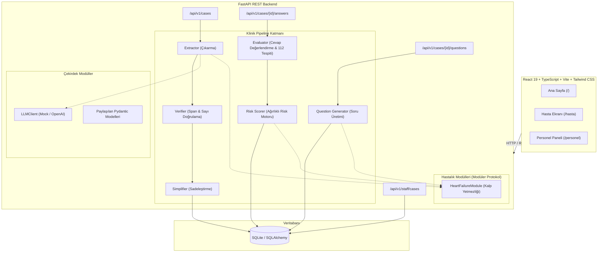

# TaburcuAI – Sistem Mimarisi Dokümantasyonu (Architecture Document)

## 1. Genel Bakış

**TaburcuAI**, kalp yetmezliği hastalarının hastaneden taburcu olurken aldıkları epikriz talimatlarının anlaşılmasını ölçen, sağlık personeline risk tabanlı hasta önceliklendirmesi sunan ve klinik güvenlik sınırları içinde çalışan yapay zeka destekli bir full-stack sağlık asistanıdır.

Proje, hekim tarafından reçete edilen tıbbi talimatları değiştirmeden veya tanı koymadan:
1. Klinik belgeden yapılandırılmış veriyi çıkarır (**Extraction**),
2. Çıkarılan her bilgiyi orijinal metinle birebir doğrular (**Verification & Grounding**),
3. Hastanın anlayabileceği sade bir günlük zaman çizelgesine dönüştürür (**Simplification**),
4. İnteraktif teach-back yöntemiyle hastanın kavrama düzeyini ölçer (**Teach-Back Evaluation**),
5. Sağlık personeline risk öncelikli bir klinik takip listesi sunar (**Risk Scoring & Staff Dashboard**).

---

## 2. Sistem Mimarisi Diyagramı



---

## 3. Temel Mimari Prensipler

### 3.1. Çekirdek ve Hastalık Modülü Ayrımı (`DiseaseModule` Protokolü)
`app/core/` paketi hiçbir hastalığa özgü tıbbi bilgi barındırmaz. Kalp yetmezliği veya gelecekte eklenebilecek KOAH, Diyabet gibi hastalıklar `app/diseases/<hastalik>/` altında modüler olarak tanımlanır.

Tüm hastalık modülleri aşağıdaki Python `Protocol` arayüzünü uygular:

```python
class DiseaseModule(Protocol):
    id: str
    extraction_schema: type
    def extraction_prompt(self, discharge_text: str) -> str: ...
    def question_templates(self) -> list[dict[str, Any]]: ...
    def risk_rules(self) -> list[dict[str, Any]]: ...
    def safety_rules(self) -> list[dict[str, Any]]: ...
    def emergency_message(self) -> str: ...
```

Bu sayede yeni bir hastalık eklenirken çekirdek pipeline kodunda tek bir satır dahi değişiklik yapılması gerekmez.

### 3.2. Sıfır Halüsinasyon ve `source_span` Doğrulaması
LLM tarafından üretilen hiçbir ilaç veya kontrol randevusu doğrudan kabul edilmez:
- Çıkarılan her öğe, orijinal belgedeki harfi harfine alıntıyı (`source_span.text`) içermek zorundadır.
- `verifier.py` bu alıntıyı orijinal metinde arar; karakter ofsetlerini (`start`, `end`) kesinleştirir.
- İlaç dozlarındaki sayılar regex ile metinle karşılaştırılır.
- Metinde bulunmayan veya eşleşmeyen ifadeler anında filtrelenir ve `missing_fields` listesine eklenir.

### 3.3. Klinik Güvenlik ve Acil Durum Sınırları
- **Tedavi Değiştirmeme:** Sistem asla yeni ilaç veya doz öneremez, var olan dozu değiştiremez.
- **Acil Durum Önceliği (112):** Hastanın cevabında göğüs ağrısı, şiddetli nefes darlığı, bayılma gibi kırmızı bayrak semptomları tespit edilirse, LLM üretimi olmayan **sabit 112 Acil Durum Uyarısı** anında devreye girer.
- **Yasal Uyarı:** Tüm hasta çıktılarında *"Bu bilgi hekiminizin yazdığı talimatın sadeleştirilmiş halidir; sorunuz varsa hekiminize danışın"* ifadesi zorunludur.

---

## 4. Veri Modelleri (Veritabanı Şeması)

Sistem SQLite üzerinde SQLAlchemy 2.0 ile çalışır:

1. **`cases` (Vakalar):**
   - `id` (UUID): Benzersiz vaka kimliği.
   - `disease`: Hastalık türü (`heart_failure`).
   - `raw_text`: Orijinal epikriz metni.
   - `discharge_info` (JSON): Doğrulanmış klinik şema (`DischargeInfo`).
   - `simplified_plan` (JSON): Hastaya özel sadeleştirilmiş günlük plan (`SimplifiedPlan`).
   - `created_at`: Kayıt zamanı.
2. **`case_questions` (Sorular ve Cevaplar):**
   - `id`: Benzersiz soru kimliği.
   - `case_id`: İlişkili vaka.
   - `text`: Hastaya sorulan teach-back sorusu.
   - `expected_points` (JSON): Beklenen klinik kavramlar.
   - `criticality`: `high`, `medium`, `low`.
   - `patient_answer`: Hastanın serbest metin cevabı.
   - `verdict`: `correct`, `partial`, `incorrect`, `unclear`.
   - `matched_points` & `missing_points` (JSON): Eşleşen ve eksik kalan noktalar.
3. **`case_risk_reports` (Risk Raporları):**
   - `id`: Rapor kimliği.
   - `case_id`: İlişkili vaka.
   - `overall_score`: 0 (tam uyum) – 100 (yüksek risk) arası puan.
   - `level`: `low`, `medium`, `high`.
   - `abstained`: Belirsiz cevap fazlalığında çekimserlik bayrağı.
   - `reasons` (JSON): Risk gerekçeleri.
   - `suggested_staff_action`: Sağlık personeline tavsiye edilen aksiyon.
   - `emergency_triggered`: Acil durum bayrağı ve mesajı.

---

## 5. Teknoloji Yığını

| Katman | Teknoloji | Seçim Gerekçesi |
|---|---|---|
| **Backend** | Python 3.11, FastAPI, Pydantic v2 | Tip güvenliği, OpenAPI / Swagger desteği, asenkron performans |
| **ORM & Veritabanı** | SQLAlchemy 2.0, SQLite | Hafif, sıfır harici kurulum gereksinimi, ACID uyumlu |
| **Frontend** | React 19, TypeScript, Vite | Hızlı geliştirme, katı tip güvenliği |
| **Stil & Tasarım** | Tailwind CSS v4, Modern UI | Erişilebilir, duyarlı ve temiz sağlık teması |
| **State & HTTP** | TanStack React Query, Native Fetch | Otomatik önbellekleme ve durum senkronizasyonu |
| **Test & Kalite** | Pytest, Ruff | Yüksek kod standartları ve otomatik CI/CD uygunluğu |
